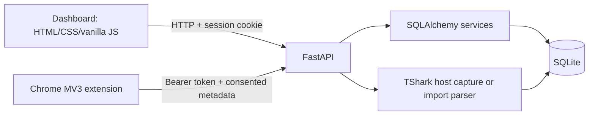

# Social Media Session Monitoring Dashboard

A local FastAPI dashboard for reviewing authenticated application sessions,
consented browser-extension activity, session inventory, and network metadata.
It is designed for authorized, local monitoring and synthetic demonstrations.
It is **not** an official Facebook or Instagram integration and does not
verify whether a social-media account is logged in.

## Features

- Protected dashboard authentication with Argon2 password hashes and
  HttpOnly SameSite session cookies.
- Responsive light-theme dashboard built with HTML, CSS, and vanilla
  JavaScript.
- Chrome Manifest V3 extension pairing, consent, pause/disconnect, device
  expiry, revocation, and sanitized activity ingestion.
- Separate Facebook and Instagram browser-activity status:
  `recently_active`, `inactive`, or `unknown`.
- Session inventory records with refresh and revoke actions. Inventory
  authentication remains `unverified` unless a supported verification method
  exists.
- Clearly labelled synthetic demo sessions and mock provider connections.
- Network CSV/JSON metadata import, protocol statistics, optional authorized
  host-based TShark capture, deduplication, and default IP redaction.
- SQLite persistence through SQLAlchemy and additive, idempotent migrations.
- Docker Compose deployment with a persistent named volume and Docker-safe
  live-capture defaults.
- Pytest coverage for API behavior and Node syntax checks for dashboard
  JavaScript.

Recent browser activity can show that the extension observed navigation or tab
activity. It does not prove account authentication, identify an account, or
confirm a valid third-party session. Synthetic records are not real social
media data.

## Architecture



- `app/main.py` creates the FastAPI application, mounts static files, serves
  templates, and registers routers.
- Routers handle authentication, dashboard sessions, browser activity,
  session inventory, and monitoring.
- SQLAlchemy models persist users, sessions, extension devices, activity,
  inventory records, network observations, providers, and consent events.
- The extension is deliberately separate from the Docker image and runs in
  the host browser.

## Project structure

```text
app/
  main.py
  config.py
  database.py
  models/             SQLAlchemy models
  routers/            FastAPI endpoints
  schemas/            Pydantic request/response models
  services/           authentication, activity, import, provider, TShark logic
  templates/          dashboard and demo HTML
  static/             dashboard and demo CSS/JavaScript
browser-extension/   Chrome Manifest V3 extension and tests
scripts/              optional local synthetic browser driver
tests/                isolated SQLite pytest suite
Dockerfile
docker-compose.yml
.env.example
requirements.txt
README.md
```

## Requirements

### Required for local development

- Windows PowerShell
- Python 3.12
- Dependencies from `requirements.txt`

### Optional

- Docker Desktop with the WSL 2 Linux engine
- Node.js for `node --check`
- Wireshark/TShark and Npcap for authorized host-based capture only
- Playwright and Chromium for the optional synthetic browser driver

## Local setup

```powershell
py -3.12 -m venv .venv
.\.venv\Scripts\Activate.ps1
pip install -r requirements.txt
Copy-Item .env.example .env
uvicorn app.main:app --reload
```

If `.env` already exists, preserve it and edit only the settings you intend
to change. Never commit `.env`. Open:

- Dashboard: <http://127.0.0.1:8000/>
- API documentation: <http://127.0.0.1:8000/docs>
- Readiness check: <http://127.0.0.1:8000/health>

The `/demo` page starts a local synthetic account and creates only local
records. It does not visit or collect data from third-party services.

## Docker

Docker Desktop must already be installed and running. Verify:

```powershell
docker version
docker compose version
wsl --status
```

Build and start:

```powershell
docker compose build
docker compose up -d
docker compose ps
docker compose logs --tail=100 app
```

The service publishes port `8000`, runs Uvicorn without reload as a non-root
user, and checks `/health`. The SQLite database is stored in the named
`app-data` volume mounted at `/app/data`.

```powershell
docker compose restart
docker compose down
docker compose up -d
docker compose up -d --build
```

`docker compose down` preserves the named volume. Do **not** use
`docker compose down -v` as routine cleanup. Back up the database before
upgrades or manual maintenance.

Docker Compose explicitly sets:

```text
NETWORK_CAPTURE_ENABLED=false
NETWORK_CAPTURE_INTERFACE=
TSHARK_EXECUTABLE=
```

Windows Npcap interface names and Windows executable paths do not work
unchanged inside the Linux container. Network import, stored observations,
statistics, and the dashboard remain available. Live capture remains
host-dependent unless a separate Linux-compatible capture setup is actually
configured and verified.

## Browser extension

The extension runs in Chrome on the host, not inside Docker.

1. Start the backend at `http://127.0.0.1:8000`.
2. Open `chrome://extensions`.
3. Enable **Developer mode**.
4. Choose **Load unpacked** and select `browser-extension`.
5. Open the extension popup and confirm the backend URL.
6. Sign in to the dashboard and create a short-lived pairing code with
   `POST /browser-extension/pairing/start`.
7. Enter the code and an installation label in the popup, then choose
   **Pair extension**.
8. Review the consent notice and choose **Enable monitoring**.
9. Use **Pause monitoring** to stop collection while retaining pairing, or
   **Disconnect** to clear the local bearer token.
10. Revoke the server-side device from the dashboard when finished.

When enabled, the extension sends normalized supported domains, event types,
timestamps, consent version, duration estimates, and limited transition/tab
metadata. It does not collect full URLs, page contents, cookies, passwords,
form inputs, request contents, access tokens, or browser session credentials.

## API overview

Interactive documentation is available at `/docs`.

### Authentication

- `POST /auth/login` — create a dashboard session.
- `GET /auth/me` — return the current user.
- `POST /auth/logout` — revoke the current dashboard session.

### Dashboard sessions

- `GET /sessions` and `GET /sessions/stats` — list and summarize application
  sessions.
- `GET /sessions/events` — list session events.
- `POST /sessions/{id}/revoke` — revoke an application session.

### Session inventory

- `POST /session-inventory` — create a supported inventory record.
- `GET /session-inventory` and `GET /session-inventory/stats` — list and
  summarize records.
- `POST /session-inventory/{id}/refresh` — refresh persisted inventory status.
- `POST /session-inventory/{id}/revoke` — revoke an inventory record.

### Browser extension and activity

- `POST /browser-extension/pairing/start` — create an authenticated,
  short-lived pairing code.
- `POST /browser-extension/pairing/exchange` — exchange a code for a device
  token.
- `GET /browser-extension/devices` and
  `POST /browser-extension/devices/{id}/revoke` — manage owned devices.
- `POST /browser-activity/events` — ingest an event using the extension bearer
  token.
- `GET /browser-activity/events` and `GET /browser-activity/stats` — retrieve
  current-user activity.
- `GET /browser-activity/status` — calculate Facebook and Instagram activity
  status using the configured inactivity threshold.

### Network and monitoring

- `POST /monitoring/network/import` — import sanitized CSV or JSON metadata.
- `POST /monitoring/network/live` — request optional authorized host capture.
- `GET /monitoring/network` and `GET /monitoring/network/stats` — retrieve
  observations and protocol counts.
- `POST /monitoring/network/retention` — delete observations older than the
  configured retention period.
- `GET/POST /monitoring/connections` and
  `POST /monitoring/connections/{id}/sync` — use the included mock provider.
- `GET/POST /monitoring/consent` — manage first-party consent records.

## Testing

```powershell
.\.venv\Scripts\python.exe -m pytest -q
node --check app\static\dashboard.js
node --test browser-extension\tests\domain_utils.test.js
```

The Python tests use isolated in-memory SQLite databases. They cover
authentication, ownership, migrations, browser pairing and ingestion,
Facebook/Instagram filtering and status semantics, session inventory,
network import/redaction/deduplication, provider mocks, and dashboard
contracts. Tests do not contact social platforms or require real credentials.

## Security, privacy, and limitations

- Keep `.env`, SQLite databases, tokens, credentials, pairing codes, and logs
  out of Git.
- Passwords are hashed by the application; dashboard sessions use server-side
  records and HttpOnly cookies.
- Extension bearer tokens are stored server-side as hashes and are not placed
  in URLs or logs.
- Browser activity requires explicit extension consent and is isolated by
  authenticated user.
- Browser activity status is not account authentication and never changes
  session-inventory authentication status.
- The included provider adapter is mock-only. No official Meta OAuth/API
  integration is implemented.
- Network capture is metadata-only, redacts IP addresses by default, and
  requires authorization, suitable permissions, and a compatible host setup.
- Docker disables live packet capture by default.
- Login throttling, production secret management, backups, TLS termination,
  and operational monitoring require additional deployment work.

## Contribution and issues

For changes, preserve the existing API contracts, consent boundaries, and
database data. Add focused tests for behavior changes and run the complete
suite before opening a pull request. Bug reports should include the endpoint,
reproduction steps, relevant status code, and sanitized logs; do not attach
databases, `.env` files, tokens, cookies, or personal capture data.

## License

No license file is currently present. A license decision is required before
public distribution; this project should not be assumed to be MIT-licensed.


